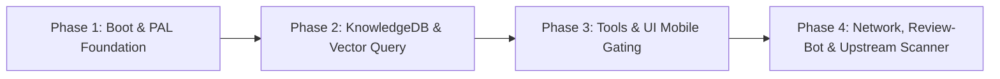

# Mobile Platform Design Specification (Vault Operator v3.8.3 Fork)

**Document Version:** 1.0.0  
**Base Upstream Version:** Vault Operator 3.8.3  
**Status:** Approved for Implementation  
**Target Architecture:** Desktop Indexer + Mobile Companion  

---

## 1. Executive Summary & Goals

### 1.1 Objective
Transform the Desktop-only Vault Operator plugin into a hybrid **Desktop Indexer + Mobile Companion** plugin supporting iOS and Android Obsidian, while maintaining full forward-compatibility with upstream updates from the core Vault Operator repository.

### 1.2 The Core Premise: Desktop-Heavy, Mobile-Light
* **Desktop (Author & Indexer):** Handles CPU- and memory-intensive operations: embedding calculation, graph extraction, community clustering, freshness evaluation, LibreOffice slide rendering, shell recipes, and Git shadow checkpoints.
* **Mobile (Query & Chat Companion):** Runs inside the sandboxed mobile WebView (iOS Safari WebKit / Android Chromium). It operates in a lightweight, read-only/query-only mode: chatting with standard LLM APIs (Anthropic, OpenAI, OpenRouter), executing Markdown skills, reading system prompts, and performing vector semantic search against the pre-computed database synced into the vault.

### 1.3 Key Constraints & Upstream Drift Prevention
Since this repository is a fork of Vault Operator release 3.8.3:
1. **Minimize Core Code Invasiveness:** Avoid scattering `if (Platform.isMobile)` checks across dozens of core files.
2. **Platform Abstraction Layer (PAL):** Encapsulate mobile-specific adaptations (filesystem, decompression, path resolution) behind clean interfaces.
3. **Traceability Markers:** Every modified upstream section must be wrapped in standardized comments (`/* FORK-MOBILE: ... */`) to allow automated conflict detection during future upstream rebases.
4. **Zero Impact on Desktop:** Desktop functionality, performance, and security allowlists must remain 100% identical to upstream.

---

## 2. Feature & Capability Matrix

| Capability | Desktop (Upstream) | Mobile Companion (Fork) | Mobile Strategy / Reason |
| :--- | :---: | :---: | :--- |
| **Basic Chat & Streaming** | Supported | **Supported** | Uses standard SDKs with Obsidian-compatible network requests. |
| **System Prompts & Rules** | Supported | **Supported** | Pure string/Markdown composition; loads from vault folder. |
| **Markdown Skills** | Supported | **Supported** | Loaded from `{vault}/.vault-operator/data/skills/`. |
| **Vault Tools** (`read_file`, `write_file`, etc.) | Supported | **Supported** | Uses Obsidian's native `app.vault` API. |
| **Semantic Vector Search** | Supported | **Supported (Query-only)** | Queries the synced `knowledge.db` via `sql.js` in-memory. |
| **Graph & Health Queries** | Supported | **Supported (Read-only)** | Reads pre-computed tables in SQLite; no heavy background jobs. |
| **Background Indexing / Ingest** | Supported | **Disabled** | Heavy embedding generation runs exclusively on desktop. |
| **Git Checkpoints & Undo Bar** | Supported | **Disabled** | No Node `fs` or shadow git repo on mobile. |
| **Local Stdio MCP Servers** | Supported | **Disabled** | Mobile cannot spawn `node` / `npx` child processes. |
| **Local MCP Server Bridge (HTTP)** | Supported | **Disabled** | Mobile cannot bind TCP listening ports (`http.createServer`). |
| **Shell Recipes (`ExecuteRecipeTool`)** | Supported | **Disabled** | Requires native binaries (`pandoc`, `soffice`, `which`). |
| **LibreOffice PPTX Rendering** | Supported | **Disabled** | Requires external LibreOffice process. |
| **Core Self-Modification** | Supported | **Disabled** | Requires `esbuild-wasm` with raw filesystem access. |
| **OAuth PKCE Loopback Servers** | Supported | **Disabled** | Use direct API keys on mobile; no local HTTP callback listener. |

---

## 3. Platform Abstraction Layer (PAL) Architecture

To decouple the codebase from desktop Node.js built-ins without rewriting upstream logic, we introduce a **Platform Abstraction Layer (PAL)** under `src/core/platform/`.

```
                    ┌───────────────────────────────┐
                    │      Core Vault Operator      │
                    │  (AgentTask, Prompts, Tools)  │
                    └───────────────┬───────────────┘
                                    │
                                    ▼
                    ┌───────────────────────────────┐
                    │   Platform Abstraction (PAL)  │
                    │      src/core/platform/       │
                    └───────┬───────────────┬───────┘
                            │               │
            Platform.isDesktopApp     Platform.isMobile
                            │               │
                            ▼               ▼
           ┌───────────────────────┐ ┌───────────────────────┐
           │ Desktop Adapter       │ │ Mobile Adapter        │
           │ - Node fs / safeFs    │ │ - app.vault.adapter   │
           │ - Node os / homedir   │ │ - In-vault root only  │
           │ - node:zlib           │ │ - Web Decompression   │
           │ - Electron safeStorage│ │ - data.json storage   │
           └───────────────────────┘ └───────────────────────┘
```

### 3.1 PAL Components

1. **`PlatformPath` (`src/core/platform/PlatformPath.ts`):**
   * Replaces direct imports of Node's `path` in shared modules.
   * On Desktop: delegates to Node's `path`.
   * On Mobile: provides POSIX string operations (`join`, `dirname`, `basename`, `normalize`) and bridges with Obsidian's `normalizePath`.

2. **`PlatformCompression` (`src/core/platform/PlatformCompression.ts`):**
   * Replaces `node:zlib.gunzipSync` in `KnowledgeDB.loadWasmBinary`.
   * On Desktop: uses `node:zlib.gunzipSync`.
   * On Mobile: uses the web standard `DecompressionStream('gzip')` (native in iOS Safari 16.4+ / Android WebView) or a synchronous fallback (`fflate`).

3. **`PlatformStorageBridge` (`src/core/platform/PlatformStorageBridge.ts`):**
   * Unifies storage routing.
   * On Desktop: allows cross-vault storage under `{vault-parent}/vault-operator-shared/`.
   * On Mobile: confines all storage strictly inside the vault under `{vault}/.vault-operator/data/`.

---

## 4. Upstream Sync & Upgrade Compatibility Strategy

A core risk of forking is "merge hell" when upstream releases new versions (e.g., v3.8.4, v3.9.0). To ensure upstream compatibility:

### 4.1 Strict Patch Marking Convention
Every change inside an existing upstream file must be enclosed in standardized comment blocks:
```typescript
// @fork-mobile-start [Phase: 1, Issue: MobileBoot]
if (Platform.isDesktopApp) {
    // Upstream Desktop code
} else {
    // Mobile Companion alternative
}
// @fork-mobile-end
```

### 4.2 Automated Compatibility Scanner (`scripts/scan-upstream-drift.mjs`)
We will provide an automated Node.js scanning script that:
1. Compares this repository against an upstream release tag (e.g. `git diff v3.8.3...v3.8.4`).
2. Identifies any upstream changes made to files marked with `@fork-mobile`.
3. Verifies that all mobile PAL abstractions (`src/core/platform/*`) remain untouched by upstream changes.
4. Flags any new upstream `require()` or Node.js imports that would break mobile execution.

### 4.3 Modified Files Inventory (Target Scope)
The fork touches only a minimal, controlled set of files:
* `manifest.json` (metadata)
* `esbuild.config.mjs` (bundling rules)
* `src/main.ts` (boot gate)
* `src/core/knowledge/KnowledgeDB.ts` (WASM loading & storage location)
* `src/core/knowledge/VectorStore.ts` (query cache guard)
* `src/core/storage/GlobalFileService.ts` (in-vault root resolution)
* `src/core/security/SafeStorageService.ts` (plaintext fallback on mobile)
* `src/core/tools/ToolRegistry.ts` (mobile tool filtering)
* `src/ui/AgentSettingsTab.ts` (hiding desktop-only tabs)

All other core files (`AgentTask.ts`, `ToolExecutionPipeline.ts`, System Prompts, Markdown parsers, Evaluators) remain **100% identical to upstream**.

---

## 5. Detailed Phase-by-Phase Implementation Plan



### Phase 1: Boot Pipeline & PAL Foundation
* **Objective:** Enable the plugin to load in mobile Obsidian without runtime crashes.
* **Tasks:**
  1. Update `manifest.json`: set `"isDesktopOnly": false`.
  2. Implement `PlatformPath` and `PlatformCompression` in `src/core/platform/`.
  3. Patch `src/main.ts`:
     - Skip `safeFs.initialize` on mobile.
     - Skip `{vault-parent}` legacy directory migrations on mobile.
     - Confine `GlobalFileService` to `{vault}/.vault-operator/data/`.
     - Skip `DeviceLocalStore` and `GitCheckpointService` on mobile.
  4. Ensure `SafeStorageService` gracefully stores credentials in `data.json` without alerting toasts.
* **Verification:** Plugin loads in Obsidian Mobile (or simulated mobile environment) with zero console exceptions.

### Phase 2: In-Vault KnowledgeDB & Vector Search
* **Objective:** Enable mobile to open the synced `knowledge.db` and perform vector search.
* **Tasks:**
  1. Patch `KnowledgeDB.loadWasmBinary`:
     - Replace `node:zlib.gunzipSync` with `PlatformCompression.decompressGzip`.
     - Replace CommonJS `require('sql.js')` with browser-safe initialization.
  2. Patch `KnowledgeDB.open`:
     - Skip `WriterLock` on mobile (no PID files).
     - Ensure path resolves to `{vault}/.vault-operator/data/knowledge.db` via `app.vault.adapter.readBinary`.
     - Open in read-only / query mode (suppress background re-indexing and disk writes on mobile).
  3. Patch `VectorStore`:
     - Add a mobile memory guard: cap the search candidate cache to avoid exceeding mobile WebKit RAM limits.
* **Verification:** Running `semantic_search` on mobile returns relevant notes from pre-computed desktop embeddings.

### Phase 3: Tool Registry, Skills & UI Gating
* **Objective:** Present a clean, touch-friendly UI and filter out desktop-only tools.
* **Tasks:**
  1. Patch `ToolRegistry.ts`:
     - On mobile, exclude `execute_recipe`, `diff_checkpoint`, `restore_checkpoint`, `manage_source`, `run_skill_script`, and all MCP tools.
  2. Patch `builtinModes.ts`:
     - Ensure modes only expose available mobile tools.
  3. Patch `SkillsManager.ts`:
     - Ensure skills load directly from `{vault}/.vault-operator/data/skills/` via `vault.adapter`.
  4. Patch Settings Tab (`AgentSettingsTab.ts`):
     - Hide Desktop-only settings on mobile: Stdio MCP, Local MCP Bridge, Shell Recipes, Git Checkpoints, and Advanced Self-Dev.
* **Verification:** The sidebar chat view operates smoothly, tool calls execute safely, and settings tab displays only mobile-relevant options.

### Phase 4: Network Verification, Review-Bot Compliance & Drift Scanner
* **Objective:** Ensure clean LLM streaming, review-bot compliance, and upgrade tooling.
* **Tasks:**
  1. Network verification: Ensure standard OpenAI, Anthropic, and OpenRouter streaming works in mobile WebViews.
  2. Review-bot compliance:
     - Run `npm run lint` and verify zero violations.
     - Confirm no floating promises, no unhandled `fetch`, and no unescaped DOM elements.
  3. Upstream Drift Tooling:
     - Create `scripts/scan-upstream-drift.mjs` to compare changes between upstream releases and the fork.
     - Document the upgrade procedure in `UPGRADE-GUIDE.md`.
* **Verification:** `npm run build`, `npm run typecheck`, and `npm run test` pass with zero regressions.

---

## 6. Risk Analysis & Mitigations

| Risk | Impact | Mitigation Strategy |
| :--- | :--- | :--- |
| **Mobile Memory Pressure (Jetsam on iOS)** | High (Obsidian crashes) | `knowledge.db` is opened in read-only mode; vector cache is pruned or lazy-loaded on mobile. |
| **Out-of-Sync Databases** | Medium (Stale search results) | Clearly inform users in the UI that indexing happens on Desktop; mobile searches the latest synced snapshot. |
| **Upstream Code Drift** | High (Merge conflicts during updates) | Enforce PAL isolation; run `scripts/scan-upstream-drift.mjs` before every upgrade rebase. |
| **Missing Network Streaming** | Medium (Stalled LLM responses) | Rely on official SDK browser fetch handlers that natively support `ReadableStream` on mobile. |

---

## 7. Implementation & Verification Status

All 4 phases of the mobile platform customization have been implemented and verified:

- [x] **Phase 1: Zero-Crash Boot & Platform Abstraction Layer (PAL)**
  - `manifest.json`: Set `"isDesktopOnly": false`.
  - Created `src/core/platform/PlatformPath.ts` and `PlatformCompression.ts`.
  - Added pure-JS FIPS 180-2 SHA-256 fallback in `src/core/utils/sha256.ts`.
  - Decoupled `GitCheckpointService`, `EsbuildWasmManager`, and `SkillFolderImporter` with lazy module proxies.
  - Adapted `GlobalFileService` to route all mobile I/O through Obsidian's `DataAdapter` into `{vault}/.vault-operator/data/`.
  - Gated desktop-only storage migrations and initialization in `src/main.ts`.

- [x] **Phase 2: In-Vault KnowledgeDB & Vector Search (query-only)**
  - Decoupled WASM binary decompression in `KnowledgeDB.ts` via `PlatformCompression.decompressGzip`.
  - Gated `WriterLock` behind `Platform.isDesktopApp`.
  - Limited mobile vector cache in `VectorStore.ts` to 25,000 candidates to prevent WebView OOM crashes.
  - Gated background auto-indexing, enrichment, and graph extraction behind `Platform.isDesktopApp`.

- [x] **Phase 3: Tool & UI Mobile Gating**
  - Gated desktop-only tools in `ToolRegistry.ts` (`execute_recipe`, `diff_checkpoint`, `restore_checkpoint`, `list_checkpoints`, `read_checkpoint`, `manage_source`, `run_skill_script`, and MCP tools).
  - Gated desktop-only settings tabs in `AgentSettingsTab.ts` (Connectors, Recipes, Plugin API, Optional Assets) and Checkpoints settings in `VaultTab.ts`.

- [x] **Phase 4: Network Verification, Review-Bot Compliance & Upstream Drift Scanner**
  - Added mobile `window.fetch` fallback in `src/api/providers/openai.ts`.
  - Created `scripts/scan-upstream-drift.mjs` and registered `"scan-drift"` in `package.json`.
  - Added unit test suite in `src/core/platform/__tests__/mobile.test.ts`.
  - Passed all verification checks: `npm run scan-drift`, `npm run test`, `npm run typecheck`, `npm run build`, and `npx eslint --quiet src/`.
